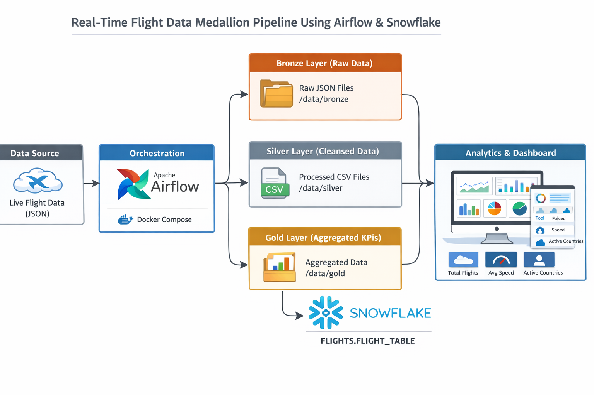
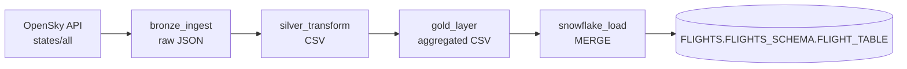

# Real-Time Flight Data Engineering Pipeline

An Apache Airflow pipeline that pulls live aircraft state vectors from the public [OpenSky Network](https://opensky-network.org/) API, processes them through a bronze / silver / gold (medallion) layout on local disk, and loads per-country aggregates into Snowflake. Airflow and its Postgres metadata database run in Docker Compose.

## Features

- Scheduled DAG (`flights_ops_medallion_pipe`) running every 30 minutes (`*/30 * * * *`), with `catchup=False`.
- **Bronze:** downloads the full OpenSky `states/all` JSON response and stores it unmodified as a timestamped file.
- **Silver:** parses the state vectors into a table and keeps `icao24`, `origin_country`, `velocity` and `on_ground`, written as CSV.
- **Gold:** aggregates by `origin_country` into `total_flights`, `avg_velocity` and `on_ground` (count of aircraft on the ground), written as CSV.
- **Snowflake load:** upserts each gold row into `FLIGHTS.FLIGHTS_SCHEMA.FLIGHT_TABLE` with a `MERGE` keyed on `(window_start, origin_country)`, so re-running a window updates rather than duplicates rows.
- Sample Snowflake dashboard queries (top countries, fastest countries, totals, trend over time) in [`docs/DOCUMENTATION.md`](docs/DOCUMENTATION.md).

## Technology stack

| Area | Technology |
| --- | --- |
| Orchestration | Apache Airflow 2.9.3 (`apache/airflow:2.9.3` image) |
| Airflow metadata store | PostgreSQL 15 |
| Containerization | Docker Compose |
| Language / libraries | Python 3.x, `requests`, `pandas`, `snowflake-connector-python` |
| Data source | OpenSky Network REST API (`https://opensky-network.org/api/states/all`) |
| Warehouse | Snowflake |

## Architecture





Tasks pass file paths to each other through Airflow XCom (`bronze_file` -> `silver_file` -> `gold_file`). Files are written under `/opt/airflow/data/{bronze,silver,gold}` inside the containers, which maps to `./data` on the host.

## Prerequisites

- Docker and Docker Compose v2
- A Snowflake account, warehouse and role that can create a database and write to it (only needed for the final task)
- Outbound internet access to `opensky-network.org` (anonymous access is rate limited by OpenSky)

## Installation and configuration

1. Clone the repository and enter it.

   ```bash
   git clone https://github.com/Puneeth0106/realtime-flight-data-engineering.git
   cd realtime-flight-data-engineering
   ```

2. Create your environment file and replace the placeholder values.

   ```bash
   cp .env.example .env
   ```

   `.env` holds the Postgres settings and Airflow admin user used by `docker-compose.yml`. It is git-ignored.

3. Create the Snowflake objects (run in a Snowflake worksheet). The SQL is also in [`docs/DOCUMENTATION.md`](docs/DOCUMENTATION.md).

   ```sql
   CREATE DATABASE IF NOT EXISTS FLIGHTS;
   CREATE SCHEMA IF NOT EXISTS FLIGHTS.FLIGHTS_SCHEMA;

   CREATE TABLE IF NOT EXISTS FLIGHTS.FLIGHTS_SCHEMA.FLIGHT_TABLE (
       window_start   TIMESTAMP,
       origin_country TEXT,
       total_flights  INT,
       avg_velocity   FLOAT,
       on_ground      INT,
       load_time      TIMESTAMP DEFAULT CURRENT_TIMESTAMP,
       PRIMARY KEY (window_start, origin_country)
   );
   ```

4. Start the stack.

   ```bash
   docker compose up -d
   ```

   `airflow-init` initializes the metadata database and creates the admin user; the web UI is then available at <http://localhost:8080>.

5. Make the Snowflake client available to the Airflow containers. The stock `apache/airflow:2.9.3` image does not necessarily include `snowflake-connector-python`, and `docker-compose.yml` does not install it (see [Known limitations](#known-limitations)). One option is to add this to the `environment` of `airflow-webserver` and `airflow-scheduler`:

   ```yaml
   _PIP_ADDITIONAL_REQUIREMENTS: "snowflake-connector-python pandas requests"
   ```

   This is intended for local experiments, not production use.

6. In the Airflow UI go to **Admin -> Connections** and create a connection with ID `flight_snowflake`:

   | Field | Value |
   | --- | --- |
   | Connection Id | `flight_snowflake` |
   | Connection Type | any generic type (for example `Generic`) |
   | Login | your Snowflake user |
   | Password | your Snowflake password |
   | Extra | `{"account": "<account_identifier>", "warehouse": "<warehouse>", "role": "<role>"}` |

   `account` is required; `warehouse` and `role` are optional. The database (`FLIGHTS`) and schema (`FLIGHTS_SCHEMA`) are hard-coded in `scripts/snowflake_implement.py`.

## Running the pipeline

1. Open <http://localhost:8080> and sign in with the admin credentials from your `.env`.
2. Unpause the `flights_ops_medallion_pipe` DAG; it then runs every 30 minutes. To run it immediately, trigger it manually.
3. Inspect outputs:
   - Bronze JSON: `data/bronze/flights_<UTC timestamp>.json`
   - Silver CSV: `data/silver/flights_silver_<YYYYMMDD>.csv`
   - Gold CSV: `data/gold/flights_gold_<YYYYMMDD>.csv`
   - Snowflake: `SELECT * FROM FLIGHTS.FLIGHTS_SCHEMA.FLIGHT_TABLE;`
4. Stop the stack with `docker compose down` (add `-v` to also delete the Postgres volume).

## Project structure

```text
.
├── dags/
│   └── flight-pipeline.py        # DAG: bronze_ingest >> silver_transform >> gold_layer >> snowflake_load
├── scripts/
│   ├── bronze_layer.py           # Fetch OpenSky states/all and store raw JSON
│   ├── silver_layer.py           # Parse state vectors, keep 4 columns, write CSV
│   ├── gold_layer.py             # Aggregate per origin country, write CSV
│   └── snowflake_implement.py    # MERGE gold rows into Snowflake FLIGHT_TABLE
├── docs/
│   ├── DOCUMENTATION.md          # Reference notes: data source, SQL setup, dashboard queries
│   └── architecture.png          # Architecture diagram
├── docker-compose.yml            # Postgres, Airflow init, webserver and scheduler
├── .env.example                  # Placeholder environment variables
├── .gitignore
├── .gitattributes
└── README.md
```

## Known limitations

- **Dependencies are not installed by the compose file.** Nothing in `docker-compose.yml` installs `snowflake-connector-python`; there is no `requirements.txt` or custom image. Without it, the `snowflake_load` task fails on import.
- **Snowflake is not tested in this repository.** There are no automated tests, and the Snowflake load requires your own account and Airflow connection.
- **Silver keeps only four columns**, and `silver_layer.py` assumes the API returns a non-empty `states` list with 17 fields per state vector (the OpenSky response format at the time of writing). A `null` or differently shaped response would make the task fail.
- **Silver and gold file names use the run date** (`ds_nodash`), so multiple runs on the same day overwrite the same silver/gold CSV. Bronze files are timestamped and are not cleaned up.
- **Snowflake load is row by row** (one `MERGE` per country) and the connection is closed without a `try/finally`.
- **Retries are disabled** (`retries: 0`), and the unauthenticated OpenSky API is rate limited.
- **Infrastructure defaults are for local use:** Postgres is published on port 5432, `restart: always` is set, and `airflow-init` waits with a fixed `sleep 10`. Webserver and scheduler use the default executor settings of the image.
- `docs/DOCUMENTATION.md` is reference material (data source, SQL setup, dashboard queries); it is not kept in sync automatically with the code.

## License

No license file is included. Until one is added, all rights are reserved by default and reuse terms are not granted.
